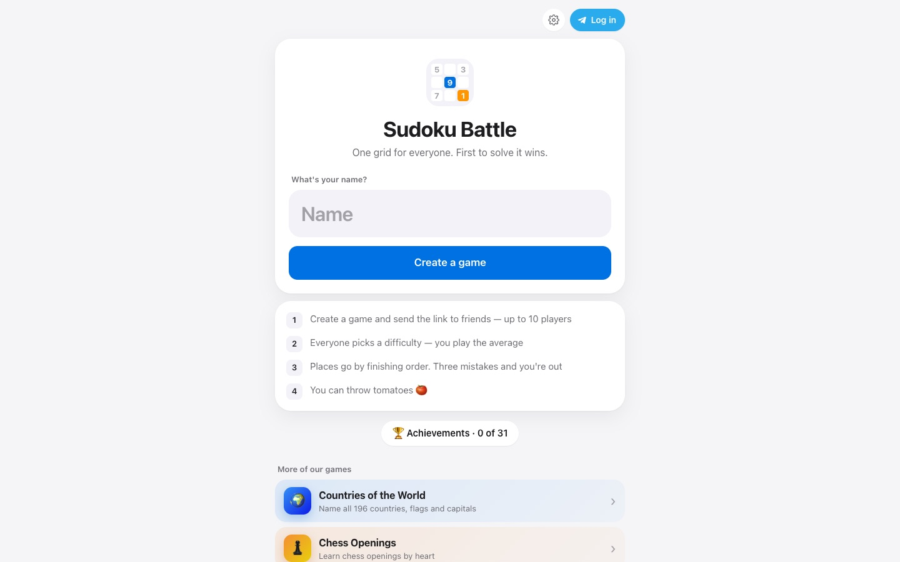

# Sudoku Battle

**[Play →](https://sudoku-duel-rosy.vercel.app)**

[](https://sudoku-duel-rosy.vercel.app)

One grid for everyone. First to solve it wins.

1. Create a game and send the link to friends — up to 10 players
2. Everyone picks a difficulty — you play the average
3. Places go by finishing order. Three mistakes and you're out
4. You can throw tomatoes 🍅

31 achievements, one shared Telegram login with my other games.

**Stack:** vanilla JavaScript, a Vercel serverless room API, Redis for game state.

```bash
node dev.mjs
```

Made by [Egor Galiy](https://egor.digital).
